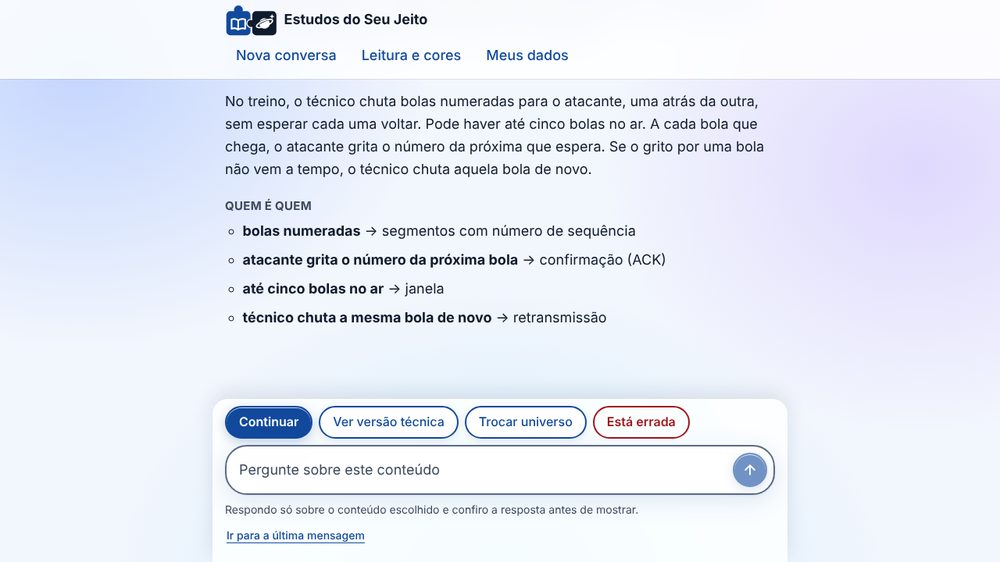
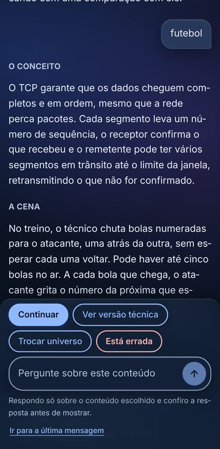

<div align="center">


# Estudos do Seu Jeito

**Aplicativo web que explica conteúdos técnicos por analogia com o universo de
que o estudante gosta: um jogo, uma série, um esporte, um anime.**

Projeto da disciplina de **Interação Humano-Computador** · Engenharia da Computação ·
**UNIARA — Universidade de Araraquara** · 2026

[Relatório final](docs/relatorio-final.docx) ·
[Documentação](docs/README.md) ·
[Avaliação (Etapa 4)](docs/etapa-4-avaliacao/avaliacao-etapa-4.docx) ·
[Como executar](#como-executar)

</div>

<table>
<tr>
<td width="72%"></td>
<td width="28%"></td>
</tr>
<tr>
<td align="center"><sub>No computador, tema claro</sub></td>
<td align="center"><sub>No celular, tema escuro</sub></td>
</tr>
</table>

---

## Sumário

- [Integrantes](#integrantes)
- [Sobre o projeto](#sobre-o-projeto)
- [Documentos do projeto](#documentos-do-projeto)
- [Por onde começar](#por-onde-começar)
- [Organização do repositório](#organização-do-repositório)
- [Tecnologias](#tecnologias)
- [Como executar](#como-executar)
- [Dados da pesquisa](#dados-da-pesquisa)
- [Uso de ferramentas de IA no desenvolvimento](#uso-de-ferramentas-de-ia-no-desenvolvimento)

---

## Integrantes

- Gustavo Henrique Femiano
- Jean Domiciano de Menezes
- João Pedro de Jesus Miranda
- Vinicius Gussoni Vellosa
- Yasmim Fernandes de Paula

---

## Sobre o projeto

Na pesquisa com estudantes feita na Etapa 1, o principal obstáculo relatado ao
estudar conteúdos técnicos foi a **explicação abstrata demais** (4 de 5
respondentes), e não a dificuldade de leitura. A proposta do aplicativo é tornar
o conceito concreto comparando-o com algo que o estudante já conhece bem, sem
abrir mão da correção técnica.

### Como funciona

1. O estudante conversa com o aplicativo numa interface de chat, no modelo dos
   assistentes de IA que já usa para estudar.
2. Ele escreve **o assunto** que quer entender (por exemplo, "TCP") e **o
   universo** que quer usar na comparação.
3. A explicação chega em mensagens curtas, uma parte por vez, seguindo o modelo
   *Teaching-With-Analogies* (Glynn): o conceito, a cena da analogia, a
   correspondência entre os elementos, **onde a comparação deixa de valer**, a
   versão técnica e uma pergunta para verificar o entendimento.
4. A qualquer momento é possível ver a **versão técnica, sem analogia** (e
   continuar nela), trocar de universo ou marcar a explicação como errada.
5. O estudante pode fazer perguntas, respondidas **somente dentro do assunto
   escolhido**.

### Confiabilidade do conteúdo

Analogias geradas por IA podem soar convincentes e estar erradas. Por isso:

- o assunto é procurado primeiro na **biblioteca de conteúdos revisados**; fora
  dela, a IA monta um **texto de referência**, com fontes da web quando a busca
  está disponível, ou com aviso ao estudante de que não há fontes;
- a IA escreve a explicação **a partir dessa referência**, planejando antes de
  escrever e com os critérios de avaliação explícitos no prompt;
- cada explicação passa por **autoverificação** (inspirada no
  *Chain-of-Verification*, Dhuliawala et al., 2024) e por **validadores
  automáticos**, como a exigência de que cada correspondência cite um trecho
  literal da referência;
- reprovada duas vezes, a explicação dá lugar à **explicação padrão, sem
  analogia**. Conteúdo reprovado nunca é exibido.

As decisões e seus limites estão no [ADR 0003](docs/adr/0003-autoverificacao-da-ia.md).

### Acessibilidade e privacidade

- Projetado para a **WCAG 2.2, nível AA**, com atenção a estudantes com **baixa
  visão**: texto ampliável até 200%, tema de alto contraste (amarelo sobre
  preto), conteúdo que se reorganiza sem rolagem lateral a 320 px, navegação
  completa por teclado e anúncios para leitores de tela.
- O estilo de vidro (superfícies translúcidas) mantém o texto das explicações em
  contraste AAA e é desligado no alto contraste e para quem pede menos
  transparência no sistema.
- Verificação automática com **axe-core** em todo o fluxo, no celular e no
  computador, nos três temas.
- **Nenhum dado pessoal identificável é pedido**: não há cadastro com nome ou
  e-mail, e o estudante pode ver e apagar tudo o que foi guardado (**LGPD**).

---

## Documentos do projeto

O trabalho segue o ciclo de design centrado no usuário (ISO 9241-210):
**Entender → Desenhar → Avaliar**.

| Etapa | Documentos | Situação |
|---|---|---|
| **1. Pesquisa com usuários** | [Plano de pesquisa](docs/etapa-1-pesquisa/plano-de-pesquisa.docx) · [Questionário](docs/etapa-1-pesquisa/questionario.docx) · [Síntese dos resultados](docs/etapa-1-pesquisa/sintese.docx) | Concluída (n = 5) |
| **2. Personas e cenários** | [Personas](docs/etapa-2-personas-cenarios/personas.docx) · [Análise PACT](docs/etapa-2-personas-cenarios/pact.docx) · [Cenários e tarefas](docs/etapa-2-personas-cenarios/cenarios.docx) | Concluída |
| **3. Prototipação** | [Visão geral](docs/etapa-3-prototipo/README.md) · [Decisões de design (DD01–DD39)](docs/etapa-3-prototipo/decisoes-de-design.md) · [Esboços de baixa fidelidade](docs/etapa-3-prototipo/esbocos/) · o próprio app, em [`apps/`](apps/) | Concluída |
| **4. Avaliação** | [**Documento da etapa (.docx)**](docs/etapa-4-avaliacao/avaliacao-etapa-4.docx) · [Resultados](docs/etapa-4-avaliacao/resultados.md) · [Avaliação heurística](docs/etapa-4-avaliacao/avaliacao-heuristica.md) · [Percurso cognitivo](docs/etapa-4-avaliacao/percurso-cognitivo.md) · [Auditoria WCAG 2.2](docs/etapa-4-avaliacao/auditoria-wcag.md) · [Melhorias](docs/etapa-4-avaliacao/melhorias.md) · [Evidências (capturas)](docs/etapa-4-avaliacao/evidencias/) · [Protocolo do teste](docs/etapa-4-avaliacao/protocolo-teste.md) · [SUS](docs/etapa-4-avaliacao/sus.md) | Avaliação analítica concluída; teste com usuários pendente |

**Ao longo de todas as etapas:**

| Documento | O que é |
|---|---|
| [**Relatório final (.docx)**](docs/relatorio-final.docx) | O projeto inteiro em um documento: fundamentação, metodologia, as quatro etapas, limitações e conclusão |
| [Requisitos](docs/requisitos/requisitos.md) | Requisitos funcionais e não funcionais, decisões de projeto D1–D9 e critérios de aceite |
| [Registros de decisão de arquitetura (ADR)](docs/adr/) | Stack, IA atrás de uma interface, autoverificação |
| [Índice da documentação](docs/README.md) | A cadeia de rastreabilidade e os códigos usados nos documentos |

Cada documento indica a origem do que afirma: `[questionário: item N]` para
dado da pesquisa, `[da literatura]` para fonte citada e `[hipótese da equipe]`
para suposição. É o que liga cada achado da pesquisa ao requisito, à decisão de
design, ao código e ao teste.

---

## Por onde começar

| Se você quer… | Comece por |
|---|---|
| Entender o projeto inteiro | o [relatório final](docs/relatorio-final.docx) |
| Ver como uma decisão nasceu da pesquisa | o [índice da documentação](docs/README.md), depois os [requisitos](docs/requisitos/requisitos.md) e as [decisões de design](docs/etapa-3-prototipo/decisoes-de-design.md) |
| Ver o que a avaliação encontrou | os [resultados da Etapa 4](docs/etapa-4-avaliacao/resultados.md) e as [evidências](docs/etapa-4-avaliacao/evidencias/) |
| Usar o app | [Como executar](#como-executar): com Docker, são dois comandos |
| Ler o código | [`apps/web/src/chat/Chat.tsx`](apps/web/src/chat/Chat.tsx) (a conversa) e [`apps/api/app/services/`](apps/api/app/services/) (explicação, verificação, pesquisa) |
| Ver os testes | [`apps/web/e2e/`](apps/web/e2e/) (fluxos e acessibilidade) e [`apps/api/tests/`](apps/api/tests/) |

---

## Organização do repositório

```
.
├── README.md                     Esta página
├── apps/                         O aplicativo (protótipo de alta fidelidade)
│   ├── web/                      Front-end: TypeScript + React
│   │   ├── src/chat/             A interface de conversa
│   │   ├── src/styles/           Tokens de cor, estilos e o estilo vidro
│   │   ├── public/               Símbolo do app (favicon.svg)
│   │   └── e2e/                  Testes de ponta a ponta e de acessibilidade
│   └── api/                      Back-end: Python + FastAPI
│       ├── app/routers/          Rotas da API
│       ├── app/services/         Assunto, pesquisa, explicações, autoverificação, perguntas
│       ├── app/providers/        Integração com os modelos de IA
│       ├── app/validators/       Validadores automáticos do conteúdo
│       ├── app/prompts/          Instruções enviadas à IA
│       ├── content/              Biblioteca de conteúdos revisados e explicações pré-gravadas
│       └── tests/                Testes da API
├── docs/                         Documentação do projeto de IHC
│   ├── relatorio-final.docx      Relatório final
│   ├── README.md                 Índice e cadeia de rastreabilidade
│   ├── etapa-1-pesquisa/         Plano, questionário e síntese
│   ├── etapa-2-personas-cenarios/  Personas, PACT e cenários
│   ├── etapa-3-prototipo/        Esboços e decisões de design
│   ├── etapa-4-avaliacao/        Documento da etapa, resultados, heurística, percurso,
│   │                             auditoria WCAG, melhorias, protocolo, SUS e evidências
│   ├── requisitos/               Requisitos e decisões de projeto
│   ├── adr/                      Decisões de arquitetura
│   └── imagens/                  Capturas usadas nesta página
├── compose.yaml                  Sobe banco, API e front-end com Docker
├── .env.example                  Modelo de configuração (sem segredos)
└── .github/workflows/ci.yml      Testes automáticos a cada push
```

---

## Tecnologias

| Parte | Tecnologias |
|---|---|
| Front-end | TypeScript, React 19, Vite |
| Back-end | Python 3.12+, FastAPI, Pydantic, SQLAlchemy |
| Banco de dados | PostgreSQL 18 |
| Inteligência artificial | API do Gemini: um modelo para escrever a analogia e outro, mais leve, para a referência e a verificação |
| Infraestrutura | Docker e Docker Compose; GitHub Actions |
| Testes | pytest (106 testes), Playwright e axe-core (44 testes de ponta a ponta) |

---

## Como executar

### Pré-requisitos

- [Git](https://git-scm.com/)
- [Docker Desktop](https://www.docker.com/products/docker-desktop/) (inclui o Docker Compose)
- Opcional, para usar a IA: uma chave da API do Gemini, gerada em
  [Google AI Studio](https://aistudio.google.com/apikey)

### 1. Obter o código e criar a configuração

```bash
git clone https://github.com/ViniciusVellosa/app-estudos.git
cd app-estudos
cp .env.example .env
```

No Windows (PowerShell), troque a última linha por `Copy-Item .env.example .env`.

O arquivo `.env` guarda a configuração local e **não é enviado ao repositório**.
Antes de subir, troque o valor de `POSTGRES_PASSWORD`.

### 2. Subir o aplicativo

```bash
docker compose up --build --wait
```

| Serviço | Endereço |
|---|---|
| Aplicativo | <http://localhost:5173> |
| Documentação da API | <http://localhost:8000/docs> |

Para encerrar: `docker compose down`.

Com a configuração padrão, o aplicativo funciona **sem IA**: o assunto
disponível é *Entrega confiável no TCP*, com explicação pré-gravada. Esse é o
modo usado no teste de usabilidade, para que as sessões não dependam de rede
nem de cota da API.

### 3. Ativar a IA (opcional)

No arquivo `.env`, defina:

```
EXPLANATION_PROVIDER=llm
LLM_BACKEND=openai_compatible
LLM_BASE_URL=https://generativelanguage.googleapis.com/v1beta/openai/
LLM_MODEL=gemini-3.5-flash-lite
LLM_MODEL_EXPLICACAO=gemini-3.8-flash
LLM_API_KEY=sua-chave-aqui
PESQUISA_PROVIDER=ia
```

- `LLM_MODEL_EXPLICACAO` é o modelo que escreve a analogia; o `LLM_MODEL`, mais
  leve e com cota maior, escreve a referência e faz a verificação.
- `PESQUISA_PROVIDER=ia`: para assuntos fora da biblioteca, a própria IA
  escreve a referência, sem busca, e o estudante é avisado de que não há
  fontes. Com `gemini`, o app pesquisa na web primeiro (no plano gratuito do
  Gemini, a busca não tem cota; exige faturamento ativo).

Antes de abrir o navegador, é possível conferir a configuração com uma chamada
real à API (requer o [uv](https://docs.astral.sh/uv/)):

```bash
cd apps/api
uv sync --extra llm
uv run python -m app.smoke --pesquisa "árvore B" "futebol"
```

O teste mostra o texto de referência, as fontes (quando há busca) e se a
explicação foi aprovada na verificação. Depois, suba o aplicativo novamente com
`docker compose up --build --wait`.

> O plano gratuito da API do Gemini tem limites de uso. Cada explicação gera
> algumas chamadas ao modelo (rascunho, verificação e, para assuntos novos, a
> pesquisa). Se aparecer o erro HTTP 429, o limite foi atingido; o erro
> HTTP 503 indica sobrecarga temporária do serviço.

### 4. Executar os testes

```bash
# API
cd apps/api
uv run pytest

# Interface, acessibilidade e fluxos completos (sobe a API e o front-end sozinho)
cd apps/web
npm install
npx playwright install chromium
npx playwright test
```

### 5. Executar sem Docker

Requer o [uv](https://docs.astral.sh/uv/) e o [Node.js](https://nodejs.org/) 24.

```bash
# Terminal 1: API, com banco SQLite local
cd apps/api
uv sync --extra llm
uv run fastapi dev app/main.py

# Terminal 2: front-end
cd apps/web
npm install
npm run dev
```

---

## Dados da pesquisa

As respostas do questionário da Etapa 1 **não fazem parte deste repositório**.
Os documentos apresentam apenas resultados agregados e respostas identificadas
por códigos (R01 a R05), conforme o compromisso assumido com os participantes.

---

## Uso de ferramentas de IA no desenvolvimento

Ferramentas de IA generativa (Claude, da Anthropic) foram usadas como apoio na
programação, na revisão de acessibilidade e na organização da documentação.
As decisões de projeto, a pesquisa com usuários e a avaliação são da equipe,
e as fontes consultadas estão citadas nos documentos de cada etapa.
